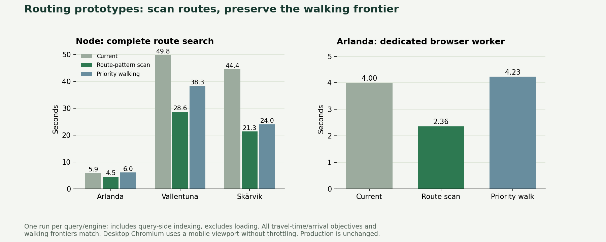

# Routing, hexagons, quadtrees and archive delivery

[Interactive comparison](https://sliso.xr.se/lab/algorithms/) ·
[Machine-readable measurements](algorithm-lab-results.json) ·
[Desktop mockup](images/algorithm-lab-desktop.png) ·
[Mobile mockup](images/algorithm-lab-mobile.png) ·
[Difference view](images/algorithm-lab-differences.png)

The most promising routing candidate is the **route-pattern scan**. Hexagons showed
similar visual error to matched-area squares and no CPU performance advantage in
this prototype. Quadtrees worked well as a **download encoding**, while ordinary
runs were faster to compose. PMTiles worked correctly but did not provide a
consistent delivery speedup with the default reader.

These measurements cover research implementations and recorded-data mockups. The
route-pattern scanner and lossless fixed-point contours have since been integrated
into production; see [integration details](production-optimization.md). The other
representations remain experiments. No routing server was introduced.



## 1. Multicriteria route-pattern search

`experiments/routing-lab/raptor.ts` implements a RAPTOR-style, boarding-round
scanner. It groups trips by route and ordered connection pattern, completes the
walking closure for a round, then scans each marked route pattern. It maintains a
separate onboard state per trip, so overtaking trips, request stops and different
pickup/dropoff restrictions remain supported. This is a custom prototype, not a
claim of a complete implementation of a published McRAPTOR package.

The exact label semantics and witness serialization are copied from the production
router. We retain departure-window anchors, continuous walking budgets, last-trip
and alighting context, GTFS transfer restrictions, mode filters and every useful
walking frontier. No heuristic label truncation was added. Existing incomplete-result
memory-budget errors remain errors, rather than being presented as finished results.

A second variant replaces FIFO walking expansion with a priority queue ordered by
displayed cost, walking already used and arrival time. It accepts fewer intermediate
labels, but its queue overhead was not a win in these measurements.

### Real-data results

Same pinned dataset `sl-68186fa6a6b514ac3e25`, date 2026-10-22, 08:07,
120 travel minutes, 30 walking minutes, four transfers, a 30-minute first-boarding
window and all modes. Each Node timing is one run and includes query-side indexing,
but excludes reading/decoding the dataset. Engines run sequentially; JIT/GC effects
and container scheduling affect these preliminary numbers. They are not statistical
performance guarantees or physical-device results.

| Origin | Current router | Route-pattern scan | Priority walking |
| --- | ---: | ---: | ---: |
| Arlanda terminal 4 | 5.86 s | 4.49 s | 6.02 s |
| Vallentuna | 49.77 s | 28.60 s | 38.25 s |
| Skärvik | 44.45 s | 21.30 s | 23.98 s |

A separate **dedicated-browser-worker** test from Arlanda measured:

| Engine | Query time | Reachable stop positions |
| --- | ---: | ---: |
| Current | 4.00 s | 7,026 |
| Route-pattern scan | 2.36 s | 7,026 |
| Priority walking | 4.23 s | 7,026 |

This browser test uses desktop Chromium with a mobile viewport, without CPU
throttling, and verified real data from a local HTTP mirror. Loading is excluded.
All three outputs have identical hashes of every stop's displayed seconds/arrival
and the complete canonical walking frontiers. This demonstrates browser-worker
execution, not just a Node implementation.

### Correctness gates

- All three real-data searches match **every stop's displayed seconds and arrival**,
  every final-walking Pareto frontier, and walking allowances at 1, 10, 30, 60, 91
  and 120 displayed minutes. Unreachable stops are included in the comparison.
- The new round scheduling can prefer fewer boardings on a tied time/arrival. The
  comparator permits fewer boardings, never more. Skärvik has one such improved
  tie in the priority-queue variant. This is not a changed travel-time result.
- Both variants pass the 40 existing routing/walking/journey/audit tests, **80 tests
  in total**, including the independent exhaustive-oracle fixtures.
- A new test compares both variants with the current router on **150 seeded
  multi-trip networks**, including overtaking, walking budgets, transfer caps,
  request stops, pickup/dropoff restrictions and scoped transfer rules.
- Witness nodes are checked against actual connection and walking-edge endpoints.

This is a strong prototype gate, not a proof covering every future GTFS feed.
Before a production switch, extend the real-query corpus and measure physical
mobile memory, cancellation/progress behaviour and end-to-end loading.

## 2. H3 versus equal-area squares

This test compares **display representations**. Every layout samples the same
recorded native result raster. It does not replace pedestrian routing or build
per-stop H3 coverage. Square cells match the measured average geographic area of
the H3 cells in each viewport; comparing nominal resolution names would be unfair.

| Area | H3 resolution 12: changed coloured pixels | Equal-area squares |
| --- | ---: | ---: |
| Central Stockholm | 1.41% | 1.44% |
| Arlanda / SkyCity | 5.87% | 5.84% |
| Lindholmen | 6.32% | 6.48% |

The metric counts changed time-band or coverage pixels divided by the coloured
union. It is a difference from the recorded display, not error against real-world
pedestrian access. Source pixels are 640 × 586, 640 × 739 and 640 × 860 respectively.
Cell centres outside the recorded image clamp to its edge; counts are recorded.

At resolution 13 the city view reaches the reference raster's sampling limit:
both layouts reconstruct its pixels exactly, with one contributing sampled cell
per pixel. **This does not imply exact geographic coverage** or additional detail.
Airport/rural views still show small differences at that finer resolution.

The H3 CPU adapter builds cell boundaries, scan-converts them into a reusable
pixel-to-cell lookup, then applies new values through that lookup. The city lookup
took about 4.7 s at resolution 12, versus 46 ms for matched squares. Subsequent
applications were about 1–3 ms. These are costs of this implementation, not an
inherent lower bound for H3. Cached geometry, offline indexing or a GPU hex renderer
could avoid much of the setup cost. We did not implement those optimizations.

The visual mockup includes H3 resolutions 12/13, their matched-area squares,
60/91/120-minute cutoffs, difference colouring, stop inspection and 2× inspection.
Stops retain their recorded journey times in every view.

## 3. Adaptive quadtrees: display and data are separate tests

The **display quadtree** recursively stores uniform regions of the existing output
raster, refining to individual reference pixels at boundaries. It reconstructs
those pixels exactly, including holes. This demonstrates adaptive representation;
it does not create a more accurate geographic travel-time model.

Separately, the **offline data quadtree** encodes each stop's existing 64 × 64,
20 m membership tiles. Leaf values retain all 30 native minute-membership bits,
including non-nested contours. Branches subdivide exactly into four children.
This codec is lossless relative to those grid samples and retains the 20 m grid's
existing spatial approximation.

| Area | RLE gzip | Quadtree gzip | RLE compose | Direct tree compose |
| --- | ---: | ---: | ---: | ---: |
| City | 11.46 MB | 4.96 MB | 95 ms | 235 ms |
| Airport | 0.23 MB | 0.11 MB | 5 ms | 9 ms |
| Lindholmen | 0.36 MB | 0.17 MB | 5 ms | 10 ms |

Sizes are offline gzip measurements of combined viewport archives. Composition
values are medians of five Node runs; physical-device and transfer timing are not
implied. The tree is smaller, but traversing it for every search was slower.

The hybrid decodes the quadtree **once into runtime runs**, then composes from the
cached runs. That conversion took about 832 ms for the city, 24 ms at Arlanda and
33 ms at Lindholmen in Node; cached composition took approximately 116, 4 and 4 ms.
Outputs match the original runs exactly. A compact wire format and a fast runtime
format can therefore be different, but conversion cost must be measured against
bandwidth savings. The expanded cache also needs a memory budget.

These experiments only cover the selected viewports. They do not establish full
regional storage size or a production tile index.

## 4. PMTiles range-delivery experiment

The official Python PMTiles 3.8.1 writer builds a v3 archive. The official PMTiles
4.3.0 JavaScript reader fetches it from a local HTTP server with real `206` byte-range
responses. Individual files and archive entries contain identical gzip payloads;
every decoded payload is SHA-256 checked. Both modes have equal application caches.

This is a **transport microbenchmark**: 25 binary chunks from the city 20 m data
are keyed by the XYZ tile containing each chunk's centre. It does not test a
complete geographic tile-selection/indexing design, a production CDN or R2.

| Injected response latency | Format | Cold six chunks | Requests | Overlapping pan | Requests |
| --- | --- | ---: | ---: | ---: | ---: |
| 0 ms | Individual files | 221 ms | 6 | 71 ms | 3 |
| 0 ms | PMTiles | 169 ms | 7 | 77 ms | 3 |
| 80 ms | Individual files | 290 ms | 6 | 145 ms | 3 |
| 80 ms | PMTiles | 622 ms | 7 | 283 ms | 3 |

These are single local-browser observations, without bandwidth throttling. Timings
include decode and checksum verification. Returning to the previously viewed chunks
requires zero requests in both modes. Cold archive access adds directory work; the
default reader still requests individual tile ranges rather than coalescing all
requested payloads into one range. PMTiles is useful for packaging and static object
storage, but this test does **not** justify adopting it for speed alone.

## Recommendation

1. Advance the route-pattern scanner to a larger regression and physical-browser
   evaluation. It is the strongest algorithm candidate here; keep production on
   the current engine until the integration gates pass.
2. Retain square/quadtree organization for computation and storage. Offer hexagons
   only if their visual presentation is preferred; no performance gain was found.
3. Consider quadtree compression for optional grid previews, with a bounded decoded
   runtime cache. Preserve full minute membership and exact vector refinement.
4. Choose archive delivery for operational needs after real CDN tests, rather than
   assuming one archive means one request.

ULTRA shortcuts, GPU hex rendering, full-region builds and physical mobile testing
remain future work. No result here claims their performance.

## Research used

- [Round-Based Public Transit Routing](https://www.microsoft.com/en-us/research/publication/round-based-public-transit-routing/): round/route organization.
- [ULTRA one-to-many multimodal routing](https://drops.dagstuhl.de/entities/document/10.4230/OASIcs.ATMOS.2020.1): relevant future preprocessing architecture; not implemented here.
- [H3 / S2 comparison](https://h3geo.org/docs/comparisons/s2/): approximate geographic versus exact quadtree subdivision.
- [PMTiles concepts](https://docs.protomaps.com/pmtiles/): archive and range-read model.

## Reproduce

First reproduce the [walking-data lab](walking-lab.md), which generates the verified
native profiles, query settings and recorded rasters used here. Large data stays
under `.data-build`; no Trafiklab request or API key is needed for this experiment.

```sh
npm install --prefix .data-build/research-deps --no-audit --no-fund h3-js@4.3.0 pmtiles@4.3.0
python -m pip install --target .data-build/research-python pmtiles==3.8.1
node experiments/routing-lab/regressions.mjs
npx tsx experiments/routing-lab/benchmark.ts /path/to/data
npx tsx experiments/walking-lab/layout-benchmark.ts
npx tsx experiments/walking-lab/delivery-build.ts
python experiments/walking-lab/delivery-build.py
node experiments/walking-lab/delivery-test.mjs
npx tsx experiments/walking-lab/hybrid.ts
npm run dev -- --port 5180
# In another terminal, with Chromium installed:
SLISO_LAB_DATA_ROOT=/path/to/data node experiments/routing-lab/browser.mjs
npx tsx experiments/walking-lab/publish-algorithms.ts
python experiments/routing-lab/plot.py  # matplotlib required
python -m http.server 5191 --bind 127.0.0.1 --directory public/lab/algorithms
# In another terminal:
node experiments/walking-lab/algorithm-smoke.mjs
```

`npm test` also runs the new seeded routing and quadtree correctness tests. The
mockup smoke test checks five alternatives, three areas and three cutoffs at widths
1440, 390 and 320, with the network disconnected after loading. It checks no extra
requests, page errors or horizontal page overflow. The mockup is a self-contained
HTML artifact with no external basemap or runtime dependencies.
