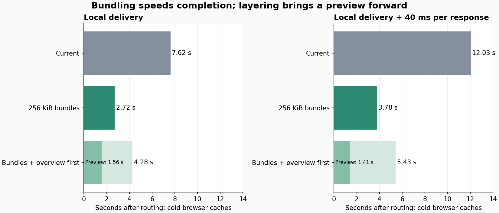
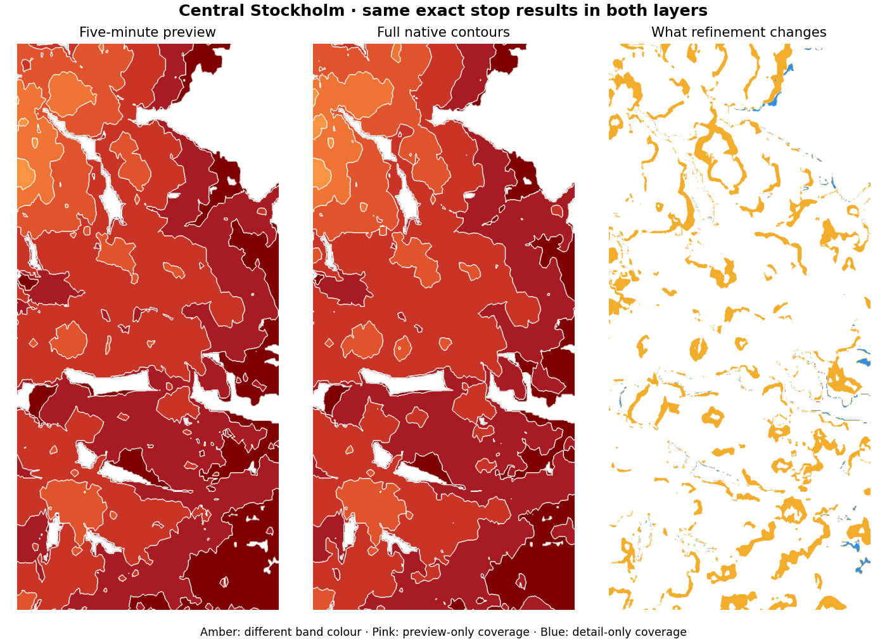

# Fewer contour fetches and layered delivery

The next change should be **spatial bundles around 256 KiB**, preserving all
native contour geometry. The prototype reduced central-Stockholm requests from
**810 to 142**, and completion from **6.3–7.6 s to 2.6–2.7 s** in two local browser
trials. Final output was pixel-identical. These are research implementations;
the live application and pinned data release were not changed by this experiment.

Layering can show an overview earlier, but should be selective. The tested preview
adds bytes and postpones exact completion; its time-band colours are approximate.
For smaller airport/rural views, directly loading the bundled native contours was
faster than adding a preview first.



[Raw measurements](delivery-layer-results.json) ·
[Preview/refinement comparison](images/delivery-layers.png) ·
[Experiment](../experiments/delivery-lab/)

## Why walking precomputation did not remove this wait

Walking-connection precomputation speeds up journey calculation. Drawing walking
areas subsequently loads another set of data: native per-stop contour profiles.
The current release has **7,153 contour files / 215.2 MB** for the entire region.
The selected city viewport needs 810 of those files, around 20.7 MB.

Every file incurs cache lookup, verification, decompression, decoding, completion
messages and scheduling. The main thread admits six concurrent requests and
waits for an animation frame before replacing completed requests. Progressive
arrivals also cause repeated raster painting. Consequently this remains costly
with zero network requests: a fresh worker rereads/decodes cached files.

## Bundling measurements

The offline prototype groups whole original archives inside approximately 1 km
cells, splitting at a compressed-size target. It copies every minute's packed
geometry bytes unchanged. All 7,153 source archives were checksum-verified, and
every written archive was decoded and checked against its inputs. No GTFS/OSM
request or new walking assumption was made.

| City view | Contour requests | Downloaded bytes | Cold completion | CacheStorage-warm completion |
| --- | ---: | ---: | ---: | ---: |
| Current files | 810 | 20.66 MB | 6.28–7.62 s | 4.67–4.69 s |
| 128 KiB target | 228 | 21.54 MB | 3.43 s | 2.69 s |
| 256 KiB target | 142 | 21.91 MB | 2.58–2.72 s | 2.14–2.29 s |
| 512 KiB target | 105 | 22.00 MB | 2.86 s | 2.57 s |

The 256 KiB candidate reduces requests by **82.5%**, with **6.1% extra bytes** for
profiles sharing a bundle but not currently contributing. Regionally it produces
2,351 files / 214.0 MB. The 512 KiB target produced fewer requests but no clear
additional speed improvement in its single sample; 256 KiB is a starting point,
not a proven universal optimum.

Adding a fixed **40 ms before each local HTTP response** gave:

| City view | Cold completion |
| --- | ---: |
| Current files | 12.03 s |
| 256 KiB bundles | 3.78 s |

This is local HTTP/1.1 keep-alive, not a simulation of cellular bandwidth, packet
loss or Cloudflare HTTP/2/3. Bundling reduces cache/worker/render overhead too;
the total gain should not be attributed entirely to network roundtrips. On a
bandwidth-limited connection, roughly 22 MB remains expensive, and overfetch can
cost more than the saved request overhead.

For a short eastward city pan, current data fetched 14 additional files / 350 KB;
256 KiB bundles fetched three / 471 KB. The initial bundle has more reusable
neighbouring data, but there is a real byte tradeoff. A 91-minute cutoff made zero
requests and took around 0.1 s in either layout.

Sparse-view checks, one cold trial each:

| View | Current | 128 KiB | 256 KiB |
| --- | --- | --- | --- |
| Arlanda / SkyCity | 31 files, 0.83 MB, 0.42 s | 13 files, 0.92 MB, 0.34 s | 12 files, 0.92 MB, 0.28 s |
| Lindholmen | 28 files, 1.02 MB, 0.55 s | 16 files, 1.07 MB, 0.46 s | 14 files, 1.07 MB, 0.53 s |

These sparse differences are small and not statistically established. Spatial
boundaries prevent filling bundles with faraway profiles merely to reach a size
target. In these cases the byte premium stayed around 5–11%.

## A necessary correctness fix: selection must not depend on packaging

The first naive repack changed edge pixels despite copying every contour exactly.
The existing renderer selects contour contributions by file membership; merging
files made additional reached profiles contribute to the padded viewport.

The successful prototype separates **logical source groups** from **physical
download files**. A stop retains its original source-group ID in optional
`walkingAreas.sources`, while `walkingAreas.index` identifies its new download
bundle. Viewport selection uses logical groups; downloading, caching and worker
retention use bundles. Moving the map resets the raster when logical contributors
change, even if the same physical bundle remains loaded.

This avoids changing coverage as a side effect of file-size tuning. The optional
metadata is absent for old releases. The prototype also verifies that each
logical source stays inside one physical bundle. It should be a production build
invariant if this layout is adopted.

## Layering experiment

I tested a complete preview before the native refinement, using two independent
rasters. The preview retains the first available contour and every five-minute
native contour. Each requested allowance uses the nearest retained minute at or
below it. It changes only temporary area graphics; **all stop times, reachability
and journey details remain unchanged**.

| City layer layout | Preview complete | Native detail complete | Total requests / bytes |
| --- | ---: | ---: | --- |
| Preview and detail in ~1 km cells | 1.59 s | 4.44 s | 245 / 27.33 MB |
| Preview in ~4 km cells, detail in ~1 km cells | 1.56 s | 4.28 s | 178 / 28.97 MB |
| Same ~4 km preview with +40 ms responses | 1.41 s | 5.43 s | 178 / 28.97 MB |

The 1.41 vs 1.56 s ordering is sample variability, not a claim that latency speeds
up previewing. With 1 km previews, adding latency instead raised preview completion
to 3.20 s and native completion to 8.38 s. A preview needs its own spatial layout:
fewer bytes alone does not remove hundreds of request/scheduling operations.

The wide preview is 514 files / 52.2 MB regionally, versus 2,221 files / 52.6 MB
for the same preview profiles in smaller cells. In the city it adds **7.06 MB**
before loading the **21.91 MB** detail. Native detail without preview was ready in
2.6–2.7 s locally, or 3.78 s with added latency. Thus the preview improves time to
a complete overview, while extending time to the complete native result.



The preview differed from native output in **13.9% of coloured city pixels**,
mostly time-band colours. Airport and Lindholmen samples differed in about
**20.9% and 21.8%**. Coverage differences were smaller: the city preview missed
2,955 coloured pixels and added 34, over a 657,152-pixel coloured union. Rounding
walking budgets downward is not a strict subset guarantee because the original
native contours are not perfectly nested.

For that reason the prototype **replaces** the preview with a separate native
raster. Adding native contributions to the existing preview would retain stale
colours or preview-only coverage. A production implementation needs an explicit
unfinished-preview state, cancellation/generation handling, and should avoid
retaining unnecessary preview geometry while refining. Two workers/fields coexist
temporarily in this prototype; app-wide peak RAM was not measured.

For the airport, wide preview took 0.34 s and final refinement 0.69 s, versus 0.28 s
for detail alone. Lindholmen took 0.36 / 0.71 s versus 0.53 s. An always-on preview
does not look worthwhile for these small views.

## Scheduling checks

Removing the animation-frame wait from request admission produced 5.41 s cold for
current city files. With 256 KiB bundles it produced **2.53 s cold / 1.83 s warm**,
and **3.68 s cold** with 40 ms responses. All final pixels still matched. This is
promising, but only one trial per condition; test UI responsiveness and cancellation
before shipping it. File fetching should not need to wait for a display refresh.

Limiting render-message dispatch to once per 200 ms was less conclusive after
bundling: 2.55 s cold / 2.32 s warm versus 2.72 / 2.14 s normally. Fewer arrivals
already reduce repaints. Do not treat a fixed 200 ms cap as a proven extra gain.

## Recommendation

1. **Ship lossless spatial bundles around 256 KiB**, with logical-source selection
   independent of physical files. This is the strongest measured improvement and
   introduces no contour-accuracy tradeoff.
2. **Decouple request admission from animation frames**, retaining bounded download
   concurrency and cancellation. Keep progressive painting as a separate scheduler.
3. **Use layers selectively for zoomed-out or broad views.** Load a small overview
   first, and load native detail on zoom-in or when the viewport settles. Keep
   precise stops available immediately. Do not automatically download both full
   layers for a view whose exact detail is already cheap.
4. For a longer-lived overview layer, test a **spatially coarse grid retaining all
   30 minute-membership bits**. Earlier experiments show why a single earliest
   minute is insufficient. This could avoid the temporal preview's five-minute
   rounding, but needs new full-region size/accuracy/delivery measurements. It was
   not implemented or benchmarked in this round.

All of these architectures use static precomputed files and browser composition.
They do not require a larger routing server, GPU service or changing the exact
transport-query algorithm again.

## Scope and reproduction

The harness ran **96 rendering phases** covering cold loading, fresh-worker
CacheStorage reuse, 91-minute cutoffs and pans. Every bundle/refinement output
matched its original-layout reference by SHA-256 of final RGBA pixels, with no
browser errors. This validates the recorded scenes, not every viewport/query or
production cancellation scenario.

Tests use desktop Chromium at a 390 × 844 mobile viewport, stage timers but no CPU
sampler. The saved queries are 2026-10-22 08:07 Europe/Stockholm, 120 travel minutes,
30 walking minutes, four transfers, all modes and a 30-minute departure window.
The city and airport use Arlanda terminal 4 results; Lindholmen uses Vallentuna
results. Stop/graph/timetable hashes match the pinned `sl-e444dbdac6b699b9d8bf`
release. Routing, initial marker setup and input preparation are excluded from
overlay timings. These are not physical-phone or full-application benchmarks.

```sh
# Use the installed pinned historical release in public/data.
npx tsx experiments/delivery-lab/fixtures.ts
python experiments/delivery-lab/prepare.py
python experiments/delivery-lab/generate.py
python experiments/delivery-lab/wide-preview.py
npx vite build --config experiments/delivery-lab/vite.config.ts
SLISO_DATA_ROOT=.data-build/delivery-lab/data SLISO_PROFILE_SITE=.data-build/delivery-lab/site SLISO_PROFILE_PORT=5197 node experiments/profiling/server.mjs
# In another shell, sequentially without other CPU-intensive work:
node experiments/delivery-lab/run.mjs city
node experiments/delivery-lab/run.mjs wide
node experiments/delivery-lab/run.mjs airport
node experiments/delivery-lab/run.mjs lindholmen
node experiments/delivery-lab/run.mjs repeat
node experiments/delivery-lab/run.mjs admission
python experiments/delivery-lab/report.py
```

The builder reads existing local release files; it never downloads traffic data.
Large generated bundles and fixtures remain in ignored `.data-build/`. The
experimental view is generated from the current production source and imports the
unchanged native renderer/codec. Its source hash is recorded; review transformations
if `src/walking-view.ts` changes. No experimental code is imported by the app.
