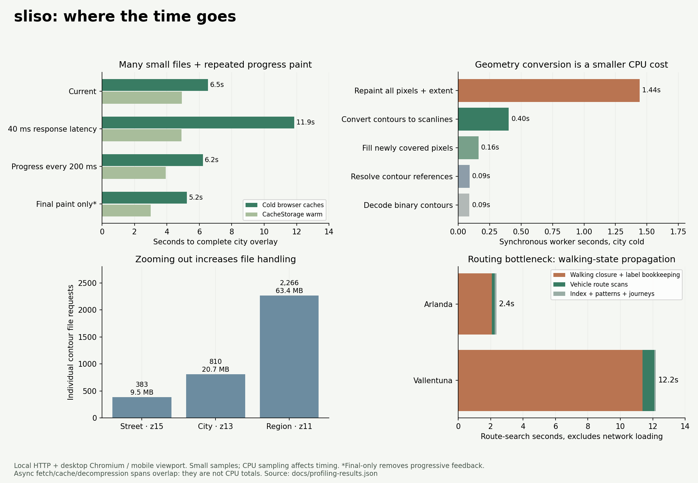

# Pipeline profiling

Follow-up: [walking-state experiments](walking-state-investigation.md) found a
2.7–4.5× routing speedup from numeric contexts and rejection before allocation,
with identical results in the tested queries. These remain isolated prototypes.

The next performance work should focus on **walking-state bookkeeping inside the
router**, and **file handling / repeated full-raster painting in the overlay**.
Contour decoding and vertex conversion are smaller costs in these measurements.
Zoom-dependent detail could still reduce bandwidth and memory, but it is not the
first CPU optimization indicated by this profile.



[Machine-readable results](profiling-results.json) · [SVG figure](images/pipeline-profile.svg)

## What was measured

Production `WalkingView`, the map worker, codec, cache verification and route
scanner now have opt-in stage timers. The harness uses the real compiled dataset,
an exact routing result prepared before timing, and real Leaflet stop markers.
Cold, CacheStorage-warm and decoded-data-warm phases are separate. Additional V8
CPU samples were captured from both the map worker and main thread; route-search
CPU profiles were collected separately.

The contour tests use Arlanda terminal 4, 2026-10-22 08:07 Europe/Stockholm,
120 travel minutes, 30 walking minutes, four transfers, all modes, and a 30-minute
first-boarding window. The city view is centred at 59.335, 18.06, zoom 13, in a
390 × 844 desktop-Chromium mobile viewport. Street and regional tests use zooms
15 and 11. Source contours are byte-identical to the published release
`sl-f86213b8fb8e39a9260c`; the local two-step migration has another immutable ID.

This isolates the walking component. It is **not the earlier full-app, 30-second
city-transition smoke test**. That measured a full-application viewport transition under request interception,
with different viewport and runtime conditions. We did not establish a
stage-by-stage explanation of that historical run, and should not treat its
30 seconds as contour-conversion CPU time.

## Overlay completion

| Condition | Cold browser caches | CacheStorage warm |
| --- | ---: | ---: |
| Normal HTTP, stage timers only | 6.49–6.59 s | 4.68–5.16 s |
| Add 40 ms response latency | 11.80–11.92 s | 4.83–4.98 s |
| Paint progress at most every 200 ms | 6.22 s | 3.93 s |
| Diagnostic: paint only at completion | 5.23 s | 3.00 s |

The normal city view fetched **810 shards / 20.7 MB**. CacheStorage-warm runs
created a fresh map worker, so they reread, verify, decompress and decode data,
but made **zero network requests**. Changing the cutoff to 91 minutes with decoded
profiles already retained took about **0.13 s**, also with zero requests.

Request interception alone measured 7.45 s cold in this isolated harness. It adds
overhead, but does not by itself reproduce or explain the historical 30-second
full-app result. First visible walking paint in the two stage-timed normal runs
arrived around 0.16–0.18 s; completion and first useful feedback are different.

The latency result is a controlled **local HTTP/1.1** test. It adds a fixed 40 ms
before each response; it does not simulate bandwidth limits, TLS, cellular packet
loss, or Cloudflare's HTTP/2/3 behaviour. It demonstrates sensitivity to many
small sequentially admitted requests, rather than predicting an exact CDN speedup.

## Full-application recheck and automation overhead

The current complete production bundle was also tested separately, using the
same real data and viewport. A date-only JavaScript shim reproduces the recorded
query date so the app's past-date guard allows it. Performance clocks, request
animation frames and timers remain native; Playwright clock emulation was not
used for these results.

With the original Playwright touch interaction used to open the legend, two full
app transitions took **19.4 and 20.4 seconds**. A DOM-click variant completed in
**7.9 seconds**, but a further standard-input run took **53.2 seconds**. That
further run spent 18.4 s in worker rendering versus 2.0–2.5 s in the earlier full
app runs, and 7.7 s in style recalculation versus 0.5–0.6 s. Its legend input itself
took only 0.43 s. This does **not** support attributing the whole difference to
the input method, network latency or contour conversion alone.

These complete-app runs are noisy diagnostics, not a reliable speedup comparison.
Their raw stage and browser performance metrics are retained in the results file.
The exact cause of the variation is unresolved; physical-device and interactive
profiling are still needed. The historical 30-second run is consequently not a
defensible contour-CPU baseline. Use the repeated, isolated stage-timed cases for
the optimization estimates below, and do not promise a 30-to-6.5-second production
speedup. The controlled latency and repaint experiments identify work worth
optimizing without claiming to explain every full-app delay.

## Where overlay CPU goes

Median accumulated synchronous stage time from the two ordinary city cold runs:

| Work | Accumulated time |
| --- | ---: |
| Repaint the full raster and scan its painted extent | 1.44 s |
| Convert contour edges to scanlines | 0.40 s |
| Fill newly improved raster cells | 0.16 s |
| Resolve contour references | 0.09 s |
| Decode / validate binary contours | 0.09 s |

The normal runs performed **87 and 97 full renders**. The 200 ms experiment
performed 31 renders cold and 20 warm. Final-only performed two renders.
**All city variants produced the same final pixel hashes**, including the partial
91-minute cutoff. The experimental message interceptor is confined to the
harness; final-only removes progressive feedback and is not a product proposal.

The instrumentation also measures cache opening/reading/writing, fetch headers,
body reads, SHA-256 and gzip decompression. **These are overlapping asynchronous
elapsed spans, not exclusive CPU times.** For example, decompression awaits also
include time while the same worker handles rendering. Their sums cannot be added
to create a 6.5-second wall-time pie. SHA-256 awaits totalled about 0.07 s in the
ordinary city runs; checksum removal is not indicated as a worthwhile shortcut.

The broader view fetched 2,266 files / 63.4 MB; street zoom fetched 383 / 9.5 MB.
Even the regional view's accumulated scanline conversion was about 0.5 s in its
sampled run. Less detailed polygons can reduce geometry work and download size,
but do not remove per-file cache/fetch/stream overhead or full-canvas colour and
extent passes.

## Routing: the main cost is walking propagation

The route-worker profile measured:

| Search | Total search | Walking closure + label bookkeeping | Vehicle route scans |
| --- | ---: | ---: | ---: |
| Arlanda | 2.36 s | 2.07 s | 0.19 s |
| Vallentuna | 12.20 s | 11.36 s | 0.73 s |

Indexing, pattern construction and journey serialization account for the small
remainder. Timetable loading/decoding took an additional 0.83 / 0.75 s, excluded
from the search column. These are browser-worker samples with CPU profiling,
not directly comparable to earlier Node timings or physical-phone timings.

About **93%** of Vallentuna's search time was in walking closure. It accepted
769,098 labels. CPU samples concentrate in `push`, `contextKey`, dominance /
settled-state checks, walking-loop object creation and garbage collection.
This is propagation of walking connections **inside the route search**, distinct
from drawing the walking overlay. The vehicle scanner is already a relatively
small part of the query.

## Recommended order of work

1. **Optimize route-state bookkeeping.** Cache stable transfer/context data,
   replace repeated string/regex keys with precomputed numeric IDs, reduce label
   allocation and repeated frontier scans. Preserve all departure anchors,
   continuous-walking budgets, scoped transfer rules and exact Pareto frontiers;
   use the existing independent oracle and real-query comparisons as gates.
2. **Benchmark spatially grouped delivery shards**, initially around 128–256 KB
   compressed, versus the current roughly 25 KB average in the city view. Reduce
   per-file fetch/cache/decompression setup while measuring geographic overfetch.
   Reuse cache handles and measure the frame wait between admitting new requests.
   Bundling is a hypothesis to benchmark; it was not implemented in this profile.
3. **Avoid repeated full-image work.** Benchmark bounded progressive updates,
   dirty rectangles/tiles, reusable colour buffers and incremental painted extents.
   The 200 ms diagnostic shows a measurable cached-load improvement while retaining
   progressive display; final-only estimates some of the avoidable work.
4. **Then evaluate zoom-dependent contour detail**, especially under constrained
   bandwidth and on physical phones. Keep exact stop/journey results and quantify
   boundary changes. The current samples do not establish the best simplification
   tolerance or its speedup.

## Reproduce and inspect

```sh
# Download the existing public release; no GTFS/OSM request or API key.
python scripts/release_data.py fetch --output .data-build/profile-data
export SLISO_DATA_ROOT="$PWD/.data-build/profile-data"
npx tsx experiments/profiling/prepare.ts
npx vite build --config experiments/profiling/vite.config.ts
node experiments/profiling/server.mjs
# In a second shell, with the same SLISO_DATA_ROOT:
node experiments/profiling/run.mjs full
node experiments/profiling/run.mjs ablation
node experiments/profiling/run.mjs routing
python experiments/profiling/report.py
# Optional complete-app recheck, in another server process:
npm run build
SLISO_PROFILE_SITE=dist SLISO_PROFILE_PORT=5193 node experiments/profiling/server.mjs
# In another shell:
node experiments/profiling/app.mjs
SLISO_APP_DOMCLICK=1 node experiments/profiling/app.mjs
```

Install the normal project dependencies, Chromium at `/usr/bin/chromium`, and
Matplotlib to generate the figure. Set `SLISO_PROFILE_DATE` during preparation if
the pinned timetable has moved beyond the recorded query date. Raw event JSON and
Chrome `.cpuprofile` files remain under `.data-build/profiling`; open CPU traces in
DevTools. The fixture generator verifies source package hashes before preparing
its result. CPU-sampled runs are diagnostic: the first sampled city cold run was
12.3 s, considerably slower than the later stage-timer-only repeats. Do not use it
as the normal wall-time baseline. Small samples and scheduling variation limit
precision; neither stage timers nor sampled JS stacks measure all native/browser
thread CPU or network behaviour.

For the application itself, add `?profile=1` before the share hash, run a query,
then read `window.__slisoProfile.snapshot()` in the console. `clear()` starts a new
capture. Tracing is disabled by default, bounded in memory, and sends no telemetry.
The diagnostic records public data URLs and timing details locally. A browser test
checks that opt-in tracing preserves pixels and that worker stage events arrive.

Validation: 68 TypeScript tests, 81 Python tests, 43 browser tests passed (one
expected desktop skip). The render-frequency experiments did not change final
pixels; no routing algorithm, contour precision or production rendering cadence
was changed as part of this profiling work.
