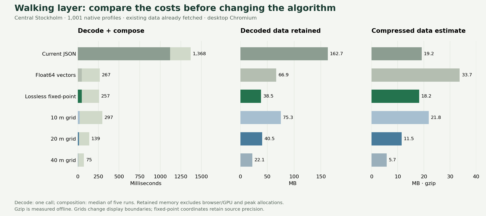

# Walking-layer alternatives: prototypes and results

The next production change I recommend is **lossless fixed-point profiles decoded
inside the rendering worker**. This removes most profile parsing and greatly reduces
the decoded data footprint while keeping the existing contours. Precomputed 20 m
tiles are worth considering as a preview layer, with exact contours for refinement.
The measurements do not support replacing every contour with a fine grid.

[Interactive mockup](https://sliso.xr.se/lab/walking/) ·
[Raw measurements](walking-lab-results.json) ·
[Desktop mockup](images/walking-lab-desktop.png) ·
[Mobile mockup](images/walking-lab-mobile.png) ·
[Difference view](images/walking-lab-differences.png)



## What was tested

The experiment uses the real, SHA-verified native walking profiles from dataset
`sl-68186fa6a6b514ac3e25`. The Arlanda terminal 4 and Vallentuna searches use
2026-10-22, 08:07, a 30-minute departure window, 120 travel minutes, 30 walking
minutes, four transfers and every mode. All Pareto walking sources are retained;
a later arrival with more remaining walking budget can still contribute.

Three viewports cover different conditions:

| View | Recorded search | Existing shards | Profiles |
| --- | --- | ---: | ---: |
| Central Stockholm | Arlanda terminal 4 | 701 | 1,001 |
| Arlanda / SkyCity | Arlanda terminal 4 | 55 | 71 |
| Lindholmen | Vallentuna | 24 | 33 |

Alternatives:

- Current JSON contours, using the existing scan conversion.
- Packed Float64 coordinates and ring/polygon offsets, read as typed-array views.
- Lossless fixed-point coordinates, with the same offsets. Every source coordinate
  must round-trip exactly at six decimal places; otherwise the contour falls back
  to Float64. No tested contour required a fallback.
- World-aligned, 64 × 64-cell tiles at 10, 20 and 40 ground metres, calibrated at
  latitude 59.335. The grid stores a 30-bit native-contour membership mask per
  covered cell. Run-length encoding omits empty cells and repeated values.
- A deliberately simpler 20 m earliest-minute grid, to test the nesting assumption.
  Its RLE uses canonical membership words; a production one-byte implementation
  could pack the values more tightly, but would retain the same semantic error.

These are working research implementations. Production routing and rendering do
not import them. The public mockup contains recorded output fields, not a new
search engine. It works offline as a self-contained HTML file.

## Browser measurements

Central Stockholm, desktop Chromium with a 390 × 844 mobile viewport, no CPU or
network throttling. Decode is one call; composition is the median of five calls.
Bytes have already been fetched. Rendering uses the same 640 × 586 output grid.

| Alternative | Gzip data¹ | Decode | Compose | Retained data² | Changed coloured pixels³ |
| --- | ---: | ---: | ---: | ---: | ---: |
| Current JSON | 19.20 MB | 1,120 ms | 248 ms | 162.7 MB | 0% |
| Float64 vectors | 33.67 MB | 49 ms | 218 ms | 66.9 MB | 0% |
| Lossless fixed-point | 18.18 MB | 48 ms | 209 ms | 38.5 MB | 0% |
| 10 m membership grid | 21.81 MB | 23 ms | 274 ms | 75.3 MB | 0.91% |
| 20 m membership grid | 11.46 MB | 14 ms | 126 ms | 40.5 MB | 1.77% |
| 40 m membership grid | 5.74 MB | 7 ms | 69 ms | 22.1 MB | 3.36% |

¹ Offline gzip of each combined viewport archive. This is not measured wire
traffic; hosting compression and the final bundle layout affect transfers.

² Isolated decoded representation after forced GC: JavaScript heap plus ArrayBuffer
backing storage. This excludes browser/native/GPU memory, transient allocations,
markers, routing data and the rest of a production tab. **It is not peak app RAM.**

³ Different time-band or coverage pixels divided by the coloured union, compared
with current contours sampled at output-pixel centres. The contours themselves are
approximate walking areas; they are not ground truth. Grid resolution changes the
display, not any stop's journey result.

Fixed-point encoding reduced retained data by about 76% and decode time by about
96% in this city case. Its combined decode and composition took about 257 ms versus
1,368 ms for JSON, after fetching. Those phase timings are not a total-search
speedup. Float64 demonstrates that binary does not automatically compress better.

### Zoom and boundary tradeoffs

| Membership-grid resolution | City pixels changed | Airport pixels changed | Lindholmen pixels changed |
| --- | ---: | ---: | ---: |
| 10 m | 0.91% | 4.18% | 4.52% |
| 20 m | 1.77% | 7.44% | 8.07% |
| 40 m | 3.36% | 13.10% | 13.82% |

The airport/rural views have narrower and more fragmented coverage, making coarse
cells more visible. Nearest-cell sampling deliberately avoids interpolation across
empty cells; cell-sized coverage shifts and lost narrow features are still possible.
The full membership grids exactly match native rasterization **at their own sampled
cell centres**. That does not make them pixel-identical at a different display grid.

The mockup includes a difference view: pink adds coverage, blue removes coverage,
and amber changes a time band. It supports 60-, 91- and 120-minute cutoffs, stop
inspection, and a 2× view. The stop times are identical in all alternatives.

### The earliest-minute assumption fails

Native contours are not perfectly nested. At 20 m, 806 of the 1,001 city profiles
had at least one sampled cell with non-nested membership. Most affected cells are
rare boundary details, but a single earliest minute cannot reproduce them.

Relative to the full 20 m membership grid at 120 minutes, earliest-only storage
changed 12 city cells, 41 airport cells and 47 Lindholmen cells. Some gained coverage
that the actual selected native contour did not contain. That additional error is
avoidable: use the complete minute-membership mask or sparse exception masks.

### Existing cutoff caching matters

The current renderer already caches the completed standard-band field. A new
91-minute cutoff in the city case took about **12 ms** with current contours and
**40 ms** with the 20 m grid prototype, including paint but excluding the UI.
A fresh grid composition can be slower than reusing the current field. A production
grid implementation would need its own incremental/cutoff cache; these results
must not be presented as improvements to every interaction.

## File-size experiment

The 20 m tiles were grouped spatially, splitting a dense tile by profile when needed.
No tested bundle exceeded its target. These measurements include all selected
profile data; the browser timing above loads one combined archive, not these bundles.

| View | Current files / summed gzip | 64 KiB target | 128 KiB target | 256 KiB target |
| --- | --- | --- | --- | --- |
| City | 701 / 19.36 MB | 218 / 10.85 MB | 114 / 10.78 MB | 63 / 10.74 MB |
| Airport | 55 / 1.85 MB | 11 / 0.227 MB | 10 / 0.226 MB | 10 / 0.226 MB |
| Lindholmen | 24 / 1.02 MB | 13 / 0.325 MB | 12 / 0.324 MB | 12 / 0.324 MB |

The city benefits substantially from reducing request count. Larger targets buy
little in sparse views because bundles retain spatial boundaries. I would start
with a 128 KiB compressed target and benchmark cold downloads and short pans on
real phones before choosing 256 KiB. This experiment does not measure RTT, bandwidth,
HTTP cache hit rate, repeated pans or worst-case off-screen overfetch.

## Precomputation and transit routing

Building all 30 native contour masks for just these selected profiles and viewport
tiles took about 4.8 seconds for the city at 20 m, 0.3 seconds at Arlanda and 0.2
seconds at Lindholmen. These single Node measurements include mask building and
tile conversion, but exclude obtaining native contours, archive compression and
regional indexing. They are not a forecast for a full regional release. Only these
viewports were generated; storage growth for every tile in the region remains unknown.

The unchanged transit searches took about **8.1 seconds from Arlanda** and **60.0
seconds from Vallentuna** in the preparation process. These are different recorded
queries, measured once in Node, not a comparison of routing algorithms. They show
that walking-layer work cannot remove the whole wait. RAPTOR has **not** been
implemented or benchmarked here. It deserves a separate exactness benchmark that
preserves departure-window costs, continuous walking budgets, GTFS transfer rules,
request stops and journey reconstruction before replacing the current router.

## Recommendation

1. Ship lossless fixed-point profiles and worker-side decoding first. The prototype
   preserves contour coordinates and removes a large object-allocation cost.
2. Keep the current exact vector refinement and existing incremental field cache.
   Consider 20 m membership tiles for a fast preview at wider zoom levels, after a
   regional-size build and cold/panning tests on physical mobile devices.
3. Preserve minute membership; do not silently assume every native contour is nested.
4. Investigate the slow transit query with a correctness-preserving routing-algorithm
   benchmark. Precomputing the overlay does not address a 60-second routing phase.

## Reproduce

Node 24 and the project's installed dependencies are required. Use the pinned,
complete real dataset for the quoted results; no demo or invented geometry is used.
The preparation script may download missing **compiled static files** from sliso.xr.se.
It never contacts Trafiklab or uses an API key. If the site no longer hosts the pinned
version, extract its archived release locally first. Local profile hashes are verified
before measurement. Supply `SLISO_LAB_DATE` when testing another feed's valid dates.

```sh
npx tsx experiments/walking-lab/prepare.ts /path/to/data
npx tsx experiments/walking-lab/run.ts
npx tsx experiments/walking-lab/fixed-benchmark.ts
npx tsx experiments/walking-lab/bundles.ts
npm run dev -- --port 5180
# In another terminal, with Chromium installed:
node experiments/walking-lab/browser-benchmark.mjs
npx tsx experiments/walking-lab/publish.ts
python -m http.server 5181 --bind 127.0.0.1 --directory public/lab/walking
# In another terminal:
node experiments/walking-lab/mockup-smoke.mjs
python experiments/walking-lab/plot.py  # requires matplotlib
```

Run `npm test` for packed-coordinate, fallback, holes/islands, clipped-view,
non-nested contour, every-minute membership, tile alignment and archive-view tests.
The standalone mockup smoke test exercises all five non-reference comparison modes
at all three cutoffs in every area, at widths 1440, 390 and 320, and checks no
horizontal page overflow, extra requests or page errors. Timing data and generated
native/profile archives stay in `.data-build`; only the compact report and visual
research artifacts are published.
